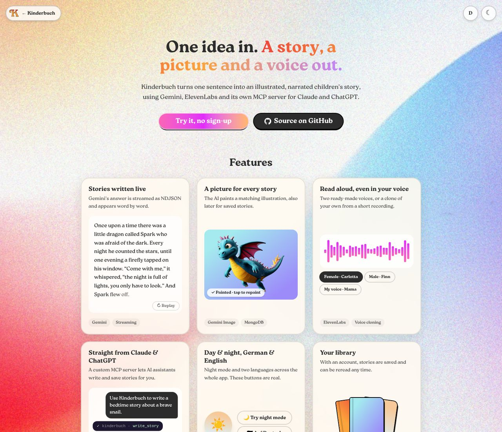
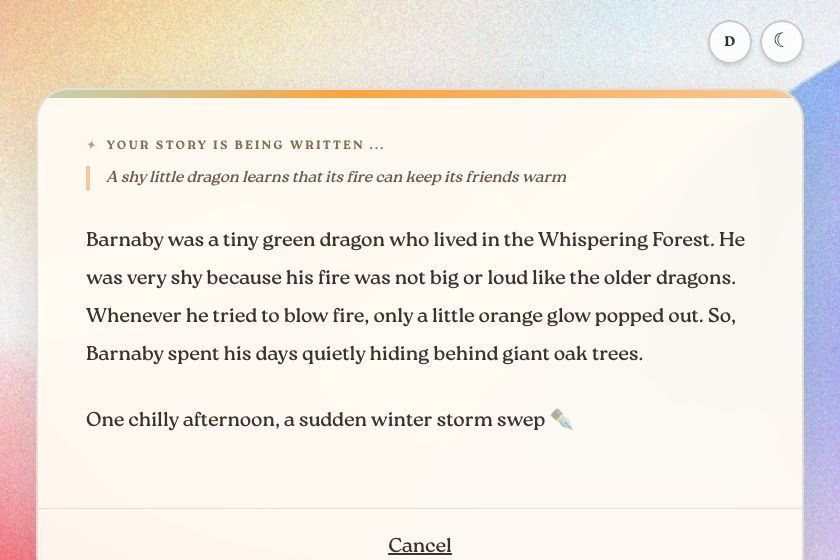
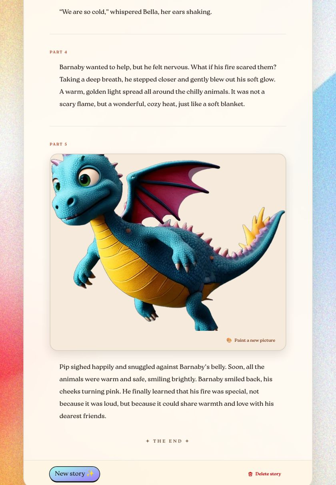
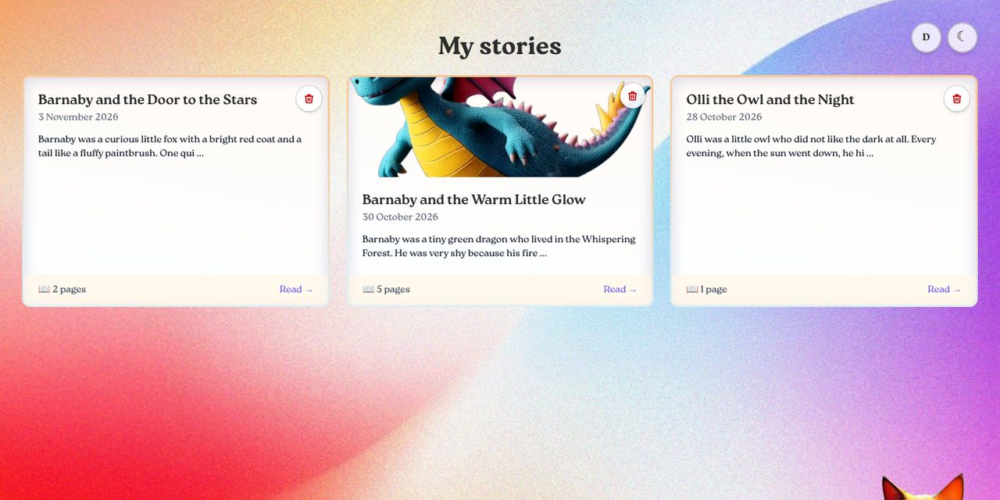
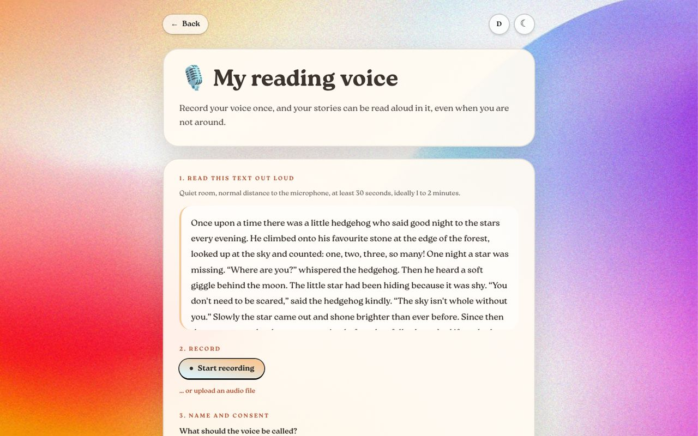
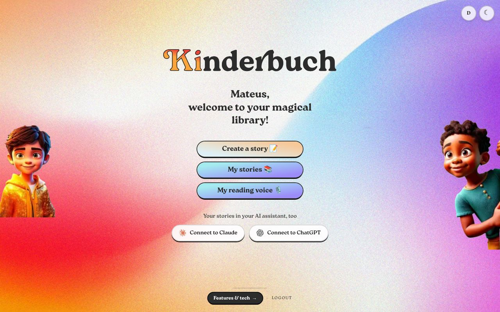
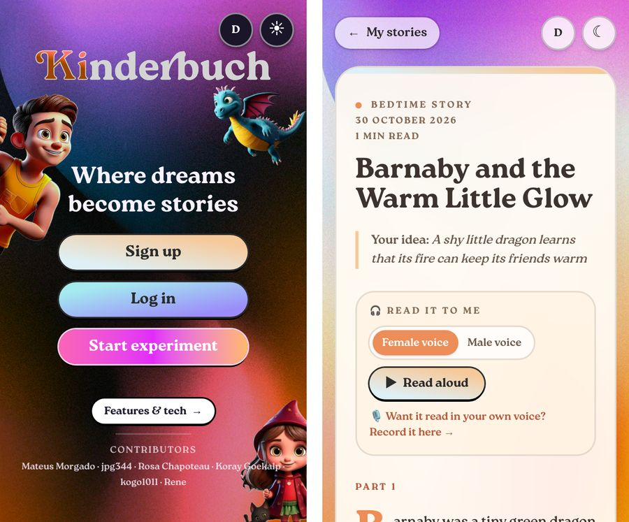
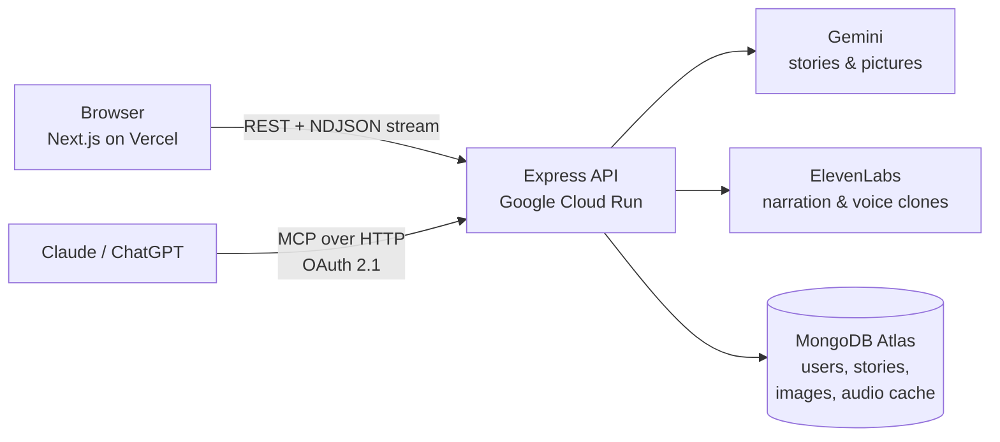

# Kinderbuch

**Type one sentence and get an illustrated children's story, read aloud, even in your own voice.**

Kinderbuch ("children's book" in German) is a full-stack AI web app: Gemini writes the story live, word by word, and paints a picture for it. ElevenLabs reads it aloud with a narrator voice or a clone of yours. A custom MCP server lets Claude and ChatGPT write stories straight into your library.

**[Try the live app](https://kinderbuch-ki.vercel.app)** (no sign-up needed) · **[Features & tech tour](https://kinderbuch-ki.vercel.app/features)**



## At a glance

- **Full stack, deployed and running:** Next.js 16 / React 19 on Vercel, an Express API on Google Cloud Run, MongoDB Atlas.
- **Three AI services in one product:** Gemini for text and images, ElevenLabs for speech and voice cloning, and an MCP server so other AI assistants can use the app.
- **Built for production:** OAuth 2.1 with PKCE, rate limits on every paid API call, caching, and 100+ automated tests running in CI on every pull request.
- **Polished UI:** responsive down to small phones, a day and night theme, German and English, keyboard support and reduced motion.

## Features

### Stories written live

You describe an idea, and the story appears word by word while Gemini writes it. The backend relays Gemini's stream to the browser as NDJSON, so the first sentence shows up almost immediately instead of after a long wait.



### A picture for every story

Every story can get an AI illustration, and saved stories can get a new one later. Logged-in users keep their stories in a personal library.

<p>
  
  
</p>

### Read aloud, even in your own voice

Stories are narrated by ElevenLabs with a female or male voice. Parents can record a minute of their own voice, and the app clones it so every story is read in that voice. Guests can try cloning once, and their voice is deleted at ElevenLabs right after.



### Straight from Claude and ChatGPT

The backend is also an [MCP](https://modelcontextprotocol.io) server. After a one-click "Connect to Claude" or "Connect to ChatGPT", you can ask your assistant for a bedtime story, and it writes, illustrates and saves it to your Kinderbuch library.



### Day and night, desktop and phone

The whole app has a night theme and works on phones, including small screens and notched displays. Everything is available in German and English.



## Tech stack

| Area | Technology |
| --- | --- |
| Frontend | Next.js 16 (App Router), React 19, Tailwind CSS v4 |
| Backend | Node.js, Express, Mongoose, Zod, Helmet, Winston |
| Database | MongoDB Atlas |
| AI | Google Gemini (text and images), ElevenLabs (text to speech, voice cloning) |
| AI integration | Model Context Protocol server (`@modelcontextprotocol/sdk`), OAuth 2.1 with PKCE |
| Auth | JWT, bcrypt |
| Hosting | Vercel (frontend), Google Cloud Run via Cloud Build (backend) |
| Quality | Jest (100+ tests), mongodb-memory-server, ESLint, GitHub Actions CI |

## Architecture



The frontend is a Next.js app that talks to one Express API. The API owns every secret and every call to Gemini and ElevenLabs, so no API key ever reaches the browser. The same API serves the MCP endpoint at `/mcp`, so Claude, ChatGPT and the website share one set of accounts, stories and rules.

```
Backend/
  app.js          Express app (exported for tests, listens only when run directly)
  routes/api/     stories, contents (generate, stream, image, narrate), voice, users
  services/       gemini, narration, voiceClone, storage, tokens
  mcp/            server.js (tools), oauth.js (login and tokens), index.js (routes)
  __tests__/      Jest tests against an in-memory MongoDB
Frontend/
  app/            pages: landing, generate, story/[id], mystories, voice, features
  app/components/ shared UI (narrator, story cards, theme and language controls)
  __tests__/      Jest tests for streaming, auth, narration and voice helpers
```

## Engineering decisions

- **Streaming instead of waiting.** A story took several seconds to generate, with nothing on screen. The API now reads Gemini's server-sent events and forwards each piece as newline-delimited JSON (`text`, `done`, `error`), which the browser renders as it arrives. An `error` event mid-stream and a dropped connection are both handled, so the user never sees half a story without an explanation.
- **Keeping AI costs under control.** Every endpoint that costs money (story, image, narration, voice cloning, login) has a rate limit per IP or per account. Narrations are cached in MongoDB, so a story is only ever sent to ElevenLabs once per voice. Guests can only request a few new narrations per hour.
- **An MCP server with real OAuth.** Claude and ChatGPT connect through OAuth 2.1 with PKCE and dynamic client registration. The user logs in on a Kinderbuch page, and the assistant receives short-lived access tokens with rotating refresh tokens. MCP tokens are signed with their own key, so they can never be used as a website login and the other way round.
- **Privacy for voice clones.** Cloning a voice is personal data. Guests can try it once: the clone is created, reads one story, and is deleted at ElevenLabs right away. Logged-in users can delete their voice at any time, and the app tells them clearly what happens to it.
- **Simple storage that fits the hosting.** Cloud Run's disk is temporary, so pictures are stored in MongoDB and served by the API. Google Cloud Storage is supported with one environment variable when the app needs to scale.
- **Tests that run the real thing.** The API tests start an in-memory MongoDB and call the real Express routes with Supertest, with Gemini and ElevenLabs mocked at the HTTP boundary. GitHub Actions runs the backend tests, frontend lint, tests and a production build on every pull request.

## Run it locally

You need Node.js 22, a MongoDB database (Atlas free tier works) and a Gemini API key. An ElevenLabs key is optional and only needed for narration and voice cloning.

```bash
# Backend, on http://localhost:8082
cd Backend
cp .env.example .env      # fill in MONGO_URI, ACCESS_TOKEN_SECRET and GEMINI_API_KEY
npm install
npm run dev

# Frontend, on http://localhost:3000 (in a second terminal)
cd Frontend
npm install               # .env.development already points at localhost:8082
npm run dev
```

Run the tests with `npm test` in either folder. To try the MCP server, point the [MCP Inspector](https://github.com/modelcontextprotocol/inspector) at `http://localhost:8082/mcp`.

## About the project

Kinderbuch started as a five-person team project at the Techstarter bootcamp in 2025. Since then I, [Mateus Morgado](https://github.com/mateusmorgado), have developed it on my own into the app it is today: live story streaming, illustrations for saved stories, narration and voice cloning, the MCP server for Claude and ChatGPT, the security and cost hardening, the test suite and CI, and the current design. The original team is credited on the app's landing page.

The original planning documents from the bootcamp (in German) are in [`Dokumentation/`](Dokumentation/).
